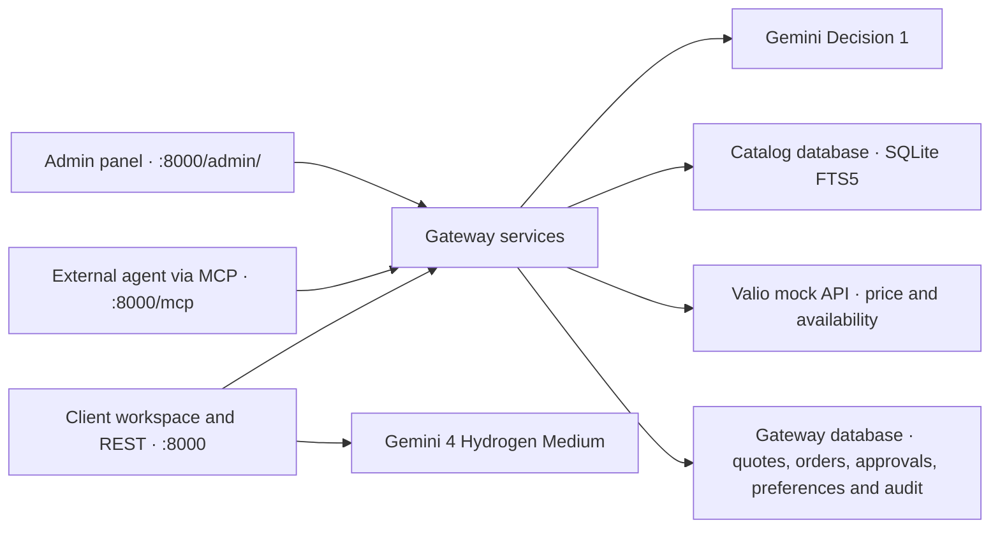

# Technology and architecture

Agent Dairy connects the Valio Aimo challenge catalog and mock APIs to kitchens, purchasing agents, and Aimo reviewers. One FastAPI app serves the buyer workspace, REST, MCP, and the admin panel at `/admin/`. A shared password session identifies the account role. Buyer APIs enforce buyer identity; operations APIs enforce admin identity independently of sidebar visibility.

## Technologies and decisions

| Technology or design | Why it fits this implementation | Evidence |
| --- | --- | --- |
| **Python 3.12, uv, FastAPI, Uvicorn and Pydantic** | The shared Python stack validates structured requests, serves the shared buyer and admin HTTP app, and generates OpenAPI. A single lockfile makes local setup reproducible. | [Manifest](../app/pyproject.toml), [lockfile](../app/uv.lock), [gateway entry point](../app/gateway/api.py), [operations entry point](../app/gateway/admin_app.py) |
| **HTML, CSS, native JavaScript modules** | The portals can run directly from the Python apps with no frontend install or build step. Browser code handles views and local session UI, while the gateway owns purchasing decisions. | [Client markup](../app/ui/index.html), [client navigation](../app/ui/workspace.js), [asset routing](../app/gateway/web_common.py) |
| **REST and MCP Streamable HTTP over shared services** | Scripted integrations can call REST and agents can discover MCP tools. Reusing quote and order services gives both the same authorization and policy rules. | [ADR 0001](adr/0001-rest-and-mcp-over-one-core.md), [MCP adapter](../app/gateway/mcp_server.py), [purchasing services](../app/gateway/service.py) |
| **SQLite and FTS5 trigram search** | Valio’s mock endpoints accept product codes. The local catalog can find those codes from Finnish substring matches and structured filters, including allergens, claims, labels, and category. The catalog can be rebuilt independently of order history. | [ADR 0004](adr/0004-sqlite-catalogue-index.md), [catalog loader](../app/gateway/load_catalog.py), [search](../app/gateway/search.py) |
| **httpx and date-specific Valio offers** | The challenge files supply static product attributes. The mock endpoints supply changing price, availability, sales blocks, and cutoffs for a shortlist. This keeps quote inputs tied to a date. | [Valio client](../app/gateway/valio_client.py), [offer rules](../app/gateway/offers.py) |
| **Gemini models and local rules** | Gemini 4 Hydrogen Medium interprets natural-language requests. Gemini Decision 1 answers fixed questions about eligible orders, and the gateway routes low-confidence answers to a human. The gateway enforces buyer and warehouse rules and commits decisions. The Anthropic integration is a separate reference runner. | [Gemini adapter](../app/gateway/gemini.py), [decision review](../app/gateway/decisions.py), [approval backend](aimo-approval.md), [reference agent](../app/gateway/agent.py) |
| **Shared portal with role checks** | Admin accounts see a sidebar entry to operations and reuse the same login. Buyer accounts cannot access operations. The legacy operations entry point remains compatible for existing integrations. | [ADR 0007](adr/0007-unified-portal.md), [client routes](../app/gateway/api.py), [operations routes](../app/gateway/operations.py) |
| **Ed25519 JWS, JWKS, and a SHA-256 audit chain** | A buyer can verify a fixed quote independently. Linked audit events preserve the sequence of policy, approval, and fulfillment decisions in the local database. | [ADR 0003](adr/0003-signed-time-bound-quotes.md), [signing](../app/gateway/quotes.py), [audit storage](../app/gateway/store.py) |

Historic ADRs describe the earlier prototype. The current tool list and approval model are described in [the developer guide](../app/README.md) and [ADR 0007](adr/0007-unified-portal.md).

## From client request to fulfillment

1. **Interpret and source.** The browser posts to `/client/chat`. The handler selects Gemini or guided parsing. Product requests go through the same MCP search and offer tools as external agents. Recipes can be compiled without a date or matched to Valio offers for a chosen date. Ranking accounts for sales-unit conversion, available quantities, pack rounding, eligibility, and substitutions. [Client assistant](../app/gateway/portal_chat.py), [kitchen sourcing](../app/gateway/kitchen.py), [planner](../app/gateway/planner.py)
2. **Create and edit a quote.** An explicit draft request performs a fresh offer check and stores a signed quote. A fully sourced recipe groups lines by SKU and checks their aggregate stock. An edit creates a newly signed quote and supersedes the old draft in the same transaction. The expiry comes from known price validity bounds and order cutoffs. The two-hour fallback is used when no cutoff is known. [Quote service](../app/gateway/service.py), [expiry](../app/gateway/quotes.py), [draft routes](../app/gateway/workspace.py)
3. **Submit and decide.** Browser drafts require an explicit client submission. Order-enabled agents can submit their own signed quotes through MCP or REST. The gateway verifies ownership, channel, signature and expiry, checks stock and signed dietary constraints, then applies the server-side mandate. Outcomes include `confirmed`, `pending_approval`, and `rejected`. Quote consumption, order state, and associated audit writes are transactional. Expired pending tickets stop reserving weekly spend. [Authorization](../app/gateway/auth.py), [mandate rules](../app/gateway/policy.py), [order lifecycle](../app/gateway/service.py)
4. **Review and fulfill.** The approval agent evaluates warehouse feasibility on submission. Eligible orders confirm automatically. Aimo staff review exceptions at `/admin/` on port 8000 against current stock, warehouse evidence, and quote expiry. The workspace derives **Aimo registered** from confirmation. Aimo staff enter subsequent fulfillment stages. Conversations and audit timelines are scoped to the order. [Approval backend](aimo-approval.md), [tracking and messages](../app/gateway/workspace.py)
5. **Report and learn.** Buyer analytics use order lines, offer checks, and timestamped status changes. Aimo reporting aggregates across clients. Recurring drift compares a SKU and sales unit with at least three confirmed same-weekday deliveries in the prior six weeks. Quantity divergence of at least 25% or unit-price divergence of at least 15% triggers review. [Buyer analytics](../app/gateway/workspace.py), [Aimo analytics](../app/gateway/operations.py), [recurring comparison](../app/gateway/recurring.py)

## Data and trust boundaries

- **Catalog.** Product JSON and reliability and carbon CSVs feed the rebuildable catalog. Carbon is an estimate based on catalog intensity and available weight. Missing factors or weights leave gaps in reporting.
- **Gateway state.** The second SQLite file stores quotes, orders, approvals, preferences, and append-only audit events. A signed quote proves what the gateway signed at quote time. The audit chain can reveal changed entries when verified against a trusted chain head.
- **Valio.** The gateway batches price and availability calls in groups of at most 1,000 IDs. Browsing may use a short outage cache marked stale. Quote creation, order submission, and approvals use fresh calls. A confirmed order remains a local record. The mock has no order or reservation endpoint.
- **Gemini.** With `GEMINI_API_KEY` configured, assistant text and selected draft details used by AI Helper are processed by Google. So are the order facts sent for the decision review, which carry no buyer identifier. Requests use server-side credentials. Quotes, policy decisions, and order writes stay in gateway code.
- **Credentials.** Demo keys map to a buyer and role. The browser uses password accounts with buyer or admin roles, or optional local demo identities and an operations key. Shared sessions preserve role checks on every protected endpoint. Production identity, tenant administration, and role assignment are deployment dependencies.
- **Production rollout.** Live reservations, automated fulfillment or messaging notifications, managed signing and rotation, external audit anchoring, and real payment processing require additional systems and agreements. Local reminders are shown while the client workspace is open. See the [production roadmap](roadmap.md).

The [workspace integration test](../app/tests/test_workspace.py) covers separate routes, draft editing, submission, ownership, status progression, conversation, analytics, preferences, and recipe input. The [Gemini test](../app/tests/test_gemini.py) and the [approval test](../app/tests/test_aimo_approval.py) check the request and response contracts with mock transports. The natural-language quality and entitlement of a real Gemini key need a live credential to verify.
