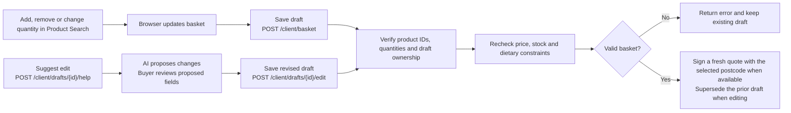

# Build or edit a basket

Renaming updates the ticket label without changing the signed quote. Deleting marks the draft as deleted. A submitted request inherits the draft name.

[Draft and basket routes](../../app/gateway/workspace.py)
