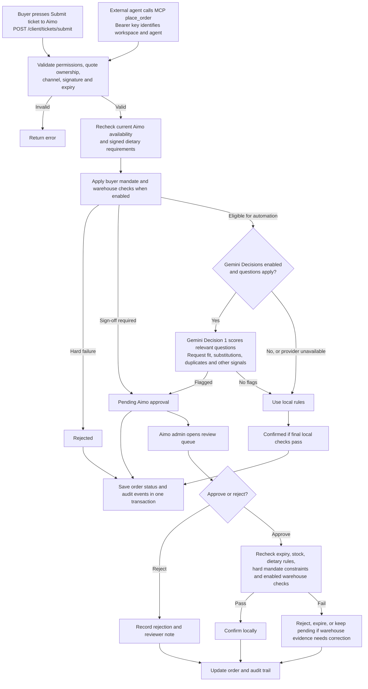

# Submit and review an order

Confirmation creates an order record in Agent Dairy. The Aimo challenge API supplies price and availability.

[Order service](../../app/gateway/service.py) · [Aimo admin routes](../../app/gateway/operations.py)
